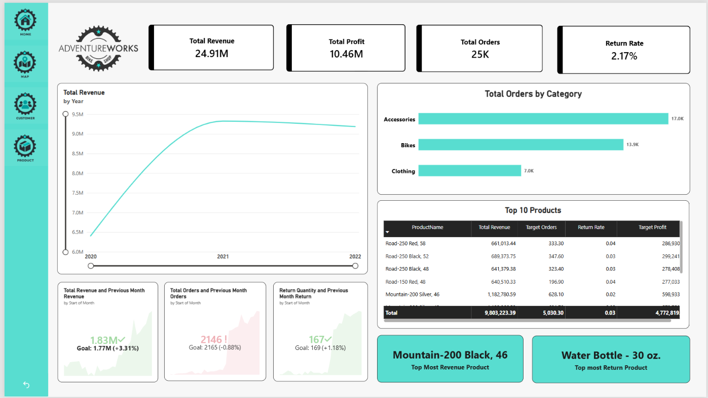
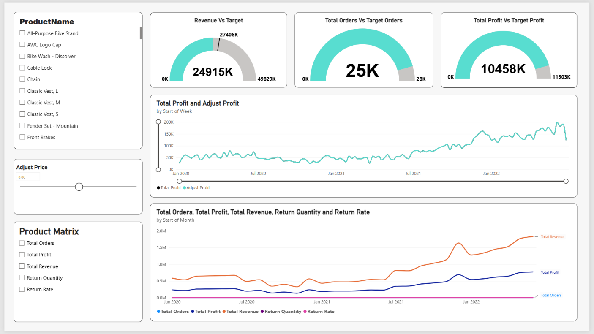
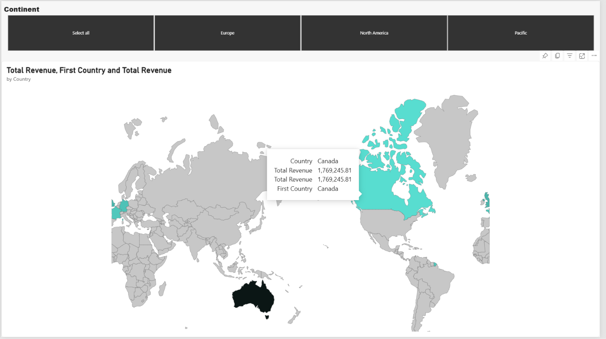
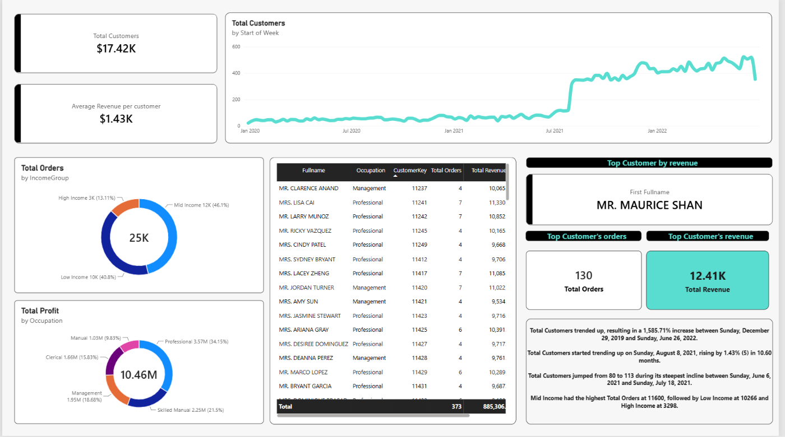

# 🚴 AdventureWorks Sales & Customer Analytics Dashboard – Power BI

## 📌 Project Overview

The **AdventureWorks Sales & Customer Analytics Dashboard** is an interactive Power BI report designed to analyze business performance across products, sales, revenue, profitability, returns, geographical regions, and customers.

The dashboard includes four interactive report pages covering executive performance, product analysis, geographical sales, and customer analytics.

## 🎯 Project Objectives

- Monitor overall revenue, profit, and order performance.
- Compare actual performance against business targets.
- Analyze product and category performance.
- Track revenue, profit, and order trends.
- Identify top-performing and most-returned products.
- Analyze geographical revenue distribution.
- Understand customer purchasing behavior.

## 🛠️ Tools & Technologies

- **Power BI Desktop** – Dashboard development
- **Power Query** – Data cleaning and transformation
- **DAX** – Measures and calculations
- **Data Modeling** – Fact and dimension tables
- **What-if Parameters** – Dynamic price adjustment

## 📊 Dashboard Features

### 1. Executive Dashboard

- Total Revenue: 24.91M
- Total Profit: 10.46M
- Total Orders: 25K
- Return Rate: 2.17%
- Revenue by Year
- Orders by Category
- Top 10 Products

### 2. Product Performance & Target Analysis

- Revenue vs Target Revenue
- Orders vs Target Orders
- Profit vs Target Profit
- Total Profit and Adjusted Profit trends
- Return Quantity and Return Rate
- Dynamic Adjust Price parameter
- Product Matrix

### 3. Geographical Sales Analysis

- Revenue by Country
- Country-wise comparison
- Continent-based filtering
- Interactive geographical map

### 4. Customer Analytics

- Total Customers
- Average Revenue per Customer
- Total Customers by Week
- Orders by Income Group
- Profit by Occupation
- Top Customer by Revenue
- Customer-level performance analysis

## 🖼️ Dashboard Preview

### 1. Executive Dashboard



### 2. Product Performance & Target Analysis



### 3. Geographical Sales Analysis



### 4. Customer Analytics



## 💡 Key Business Insights

- Monitor revenue and profit against business targets.
- Identify high-performing product categories.
- Compare product revenue and return performance.
- Explore revenue distribution across geographical regions.
- Identify valuable customers and purchasing patterns.

## 🚀 How to Use

1. Clone or download this repository.
2. Open `AdventureWorks-Dashboard.pbix` in Power BI Desktop.
3. Configure the original dataset location if required.
4. Refresh the data if the source files are available.
5. Explore the dashboard using interactive filters and slicers.

**Note:** The original dataset is not included in this repository. Data refresh may require access to the original dataset.

## 📁 Repository Structure

```text
AdventureWorks-Dashboard/
│
├── README.md
├── AdventureWorks-Dashboard.pbix
├── Customer.png
├── Executive_dashboard.png
├── Map.png
└── Product.png
```

## 📚 Skills Demonstrated

- Data Cleaning and Transformation
- Power Query
- Data Modeling
- Fact and Dimension Tables
- DAX Measures
- KPI and Target Analysis
- What-if Parameter Analysis
- Sales and Profitability Analysis
- Customer Analytics
- Data Visualization
- Business Intelligence

## 👩‍💻 Author

**Janavi Parmar**

Aspiring Data Engineer | Power BI | SQL | Python | Data Analytics

🔗 LinkedIn: Janavi Parmar

---

⭐ If you find this project useful, feel free to star the repository!
